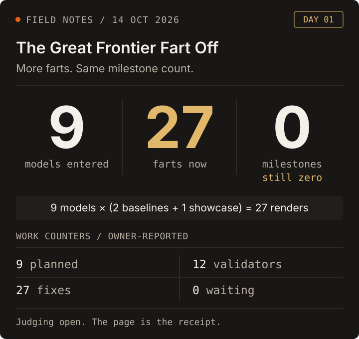
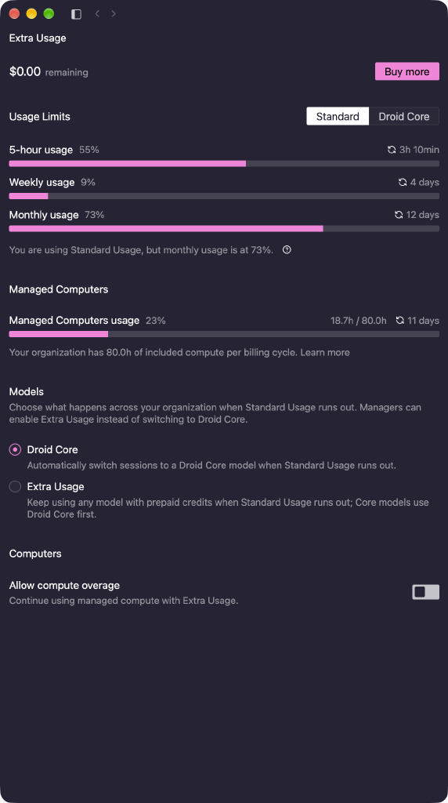

# Day 1 on the Great Frontier Fart Off: 27 farts, zero milestones

- Surface: Factory-assisted model delegations, fart-app worktrees, and the public listening page
- Date: 2026-10-14, Day 1 snapshot
- Evidence: [the listening page](https://drawmeanelephant.github.io/fart-app/contributors/fart-off.html), [issue #95 and its round-one receipts](https://github.com/drawmeanelephant/fart-app/issues/95), the owner's Day 1 counters, and the usage screenshot below
- Verdict: keep

Day 1 on the Great Frontier Fart Off. Started with 9 models and now
it's at 27 farts. But the milestone count hasn't moved at all, still 0.

Used a lot of resources. The page is great.

The top line counts contestants, renders, and my Day 1 milestone
counter. The lower line preserves my separate work counters:
**9 planned, 12 validators, 27 fixes, 0 waiting**. Those are the labels
from my notes, not four quantities to add up into 27 farts. The public
page backs the nine-model, three-renders-each count; it does not
independently establish the validator or fix counters.

## The ask was admirably stupid

The brief began: **“Make better farts.”**

Underneath it was a real engineering job. Improve `src/synth.zig`:
intestinal pressure, sphincter tension, tract resonance, pitch decay,
and noise-burst turbulence. Make vowels and plosives do something
audible. Keep the seed deterministic, the CLI working, the tests
passing, and the vendored NINJAM code untouched.

Nine models got the same verbatim brief and their own worktrees:
Gemini 4 Argon, GPT-6 Astra, GPT-6.1 Sol, Gemini 3.8 Flash, SWE-2,
Claude Sonnet 5.5, Claude Fable 5.1, Claude Opus 5.5, and Mistral
Large 4.

Each had to return three WAVs:

| Render | Comparison |
| --- | --- |
| Baseline 1 | `kujamba karibu`, seed 42, default voice |
| Baseline 2 | `shuzi kubwa sana`, seed 42, default voice |
| Showcase | The contestant's own recipe, flags allowed |

Two controlled comparisons and one chance to show off. Nine times
three is the entire explanation for the headline's 27.

## What came back

The [round-one tracker](https://github.com/drawmeanelephant/fart-app/issues/95)
reports that all nine entries built, tested, and rendered. Its later
update says the `fartoff/*` branches were pushed to origin. The
[public scorecard](https://drawmeanelephant.github.io/fart-app/contributors/fart-off.html)
has listenable AAC versions of all 27 renders, the model roster,
the parameter recipes, and instructions for rebuilding the WAVs.

That page is the satisfying part. The comparison is not trapped in
nine agent summaries saying their own farts are thunderous. There is
actual audio on the other side of the claim.

The most interesting shared decision was about the default sound.
The fixed baselines use no `--voice` flags. Keeping every old golden
fingerprint by hiding the new engine behind optional knobs would
therefore submit the old fart to the comparison.

All nine made their new engine the default. The page records
re-baselined goldens, with an exception worth keeping: Opus preserved
the original fingerprints through `classic=1` and added new ones.
Fable and Mistral independently replaced transcendental math in the
DSP to make their WAV bytes match across optimization modes.

Those are reported entry results, not a fresh nine-branch test run
by this blog. Nor does passing a fingerprint test prove that a fart
sounds better. That is why judging is by ear.

## Why the zero stays

The Day 1 milestone counter is my snapshot, not a census of every
closed milestone in the fart-app repository.

At this check, #95 is still open, its acceptance boxes are unchecked,
and the listening page says **judging is open**. There is no recorded
winner to announce here.

There is also a useful difference between the ticket and the round.
The original ticket describes an automated roster-to-scorecard driver,
JSON submissions, malformed-output handling, missing-key skips, and
an offline dry run. This round instead gave models isolated worktrees
to improve the synthesizer itself, then handed the results to human
ears. A great listening page does not by itself prove that every
original driver requirement is complete.

So: real code, real renders, a real page. Still not an excuse to move
the milestone counter for the joke.

## The resource bill, without an invented price tag

The screenshot shows:

| Meter | Reading |
| --- | --- |
| Five-hour Standard usage | 55% |
| Weekly Standard usage | 9% |
| Monthly Standard usage | 73% |
| Managed Computers | 18.7 / 80.0 hours, shown as 23% |
| Extra Usage balance | $0.00 remaining |

Those are account-wide readings at the screenshot, not resources
attributed to this competition. They do not tell me what each model
cost, how much of the monthly meter this round consumed, or what a
fart costs in dollars. The $0 balance is not a $0 cost.

The narrower verdict is enough: I used a lot of resources, and I
like what came back. Better cost accounting can wait; pretending
this screenshot supplies it cannot.

## The fart drawer

This work now has [[farts/index]], with [[farts/fart-app]] and
[[farts/brownnote]] beside each other.

Brownnote is a different kind of ridiculous: the plumbing that sends
the synth's audio through GuitarPedal's real effects core, with
zcn/NINJAM downstream. The repository already documents fuzz, effect
chains, recordings, presets, and a browser studio. It deserves its
own piece when there is a session and a listening verdict to chart,
not a made-up review stapled onto this one.

For Day 1, the receipt is the page. Nine models entered.
Twenty-seven farts came back. The zero stays until the work earns
something else.
